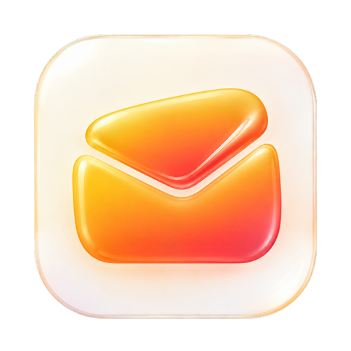
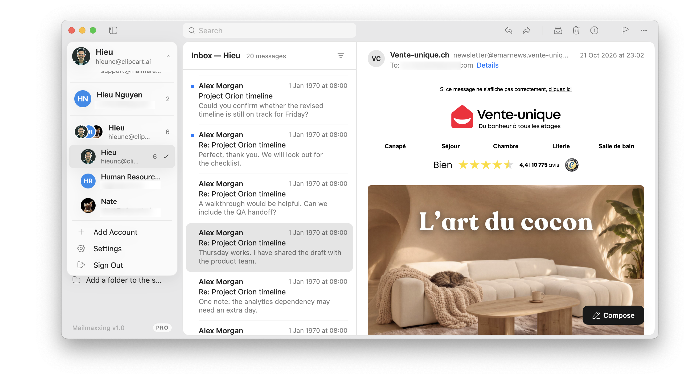

# Mailflare for macOS

A fast Mac mail app for your Mailflare server, Gmail, Outlook, iCloud and more.

This is the Mac app for [Mailflare](https://github.com/hieunc229/mailflare), the self-hosted mail platform that runs on Cloudflare. Your mail is saved on your Mac, so it opens fast and works offline.

## Features

- **Made for Mailflare.** Sign in with your password, an app password or a QR code.
- **Other accounts.** Easy setup for Gmail, Outlook, iCloud, Yahoo, Fastmail and more, or enter your own server.
- **Many accounts.** Switch accounts from the sidebar. See one inbox per address, or all together.
- **Works offline.** Read mail without internet. Your actions are sent when you reconnect.
- **Writing.** Rich text, Cc and Bcc, attachments, drafts, reply, forward, undo and redo, and templates.
- **AI Writer.** Tell the AI what to write, and it writes the email for you.
- **Organize.** Archive, delete, mark as junk, flag, move to folders, and unsubscribe from newsletters.
- **Search.** Search from the title bar. Filter by unread or flagged.
- **Safe reading.** Block remote images, and view the original message.
- **Notifications.** New-mail alerts and an unread count on the Dock icon.
- **Mac style.** Light and dark mode and keyboard shortcuts.
- **Auto updates.** The app updates itself.
- **AI assistant.** A chat panel that finds mail, drafts replies and tidies your inbox.

### Keyboard shortcuts

| Shortcut | Action |
| --- | --- |
| `⌘N` | New message |
| `⌘,` | Settings |
| `⌘R` / `⇧⌘R` | Reply / Reply all |
| `⇧⌘F` | Forward |
| `⌘⌥F` | Search |
| `⌘⌫` | Delete |
| `⌘↩` | Send |
| `⎋` | Back to inbox (from Settings) |

## AI features

Add an AI provider in **Settings → AI Providers** to turn them on. The AI never sends mail. Drafts open in the composer, and you press Send.

- **Providers.** OpenAI, Anthropic, OpenRouter, Groq, Ollama on your Mac, or a similar service. Keys are stored in the macOS Keychain.
- **Models and prompts.** Choose a model for the assistant and another for AI Writer. Each has its own custom prompt, such as your tone or sign-off.
- **Assistant.** Open it with the sparkles button in the title bar. Ask it to find emails, summarize a thread or write a reply.
- **AI Writer.** In the composer, click the sparkles button, type what you want and press Enter. You can undo the result.

The AI sends the mail it reads to your chosen provider. Use Ollama to keep everything on your Mac.

## Requirements

macOS 15.3 or later.

## Build from source

Install Xcode 16 or later, open `Mailflare.xcodeproj` and run the **Mailflare** scheme. Clone [`mailflare-core`](../mailflare-core) next to this project first.

## Privacy

- Passwords and keys stay in the macOS Keychain.
- Your mail is saved on your Mac. **Settings → About** shows where.
- The app only connects to your mail servers, GitHub (for updates) and your AI provider, if you use AI.

## Help

Found a bug or have an idea? [Create an issue on GitHub](https://github.com/hieunc229/mailflare-macos/issues). It is also in **Settings → Support**.

## Related projects

- [`mailflare`](https://github.com/hieunc229/mailflare): the server
- [`mailflare-core`](../mailflare-core): the shared engine for Mailflare apps

## License

[GNU AGPL v3](LICENSE)
